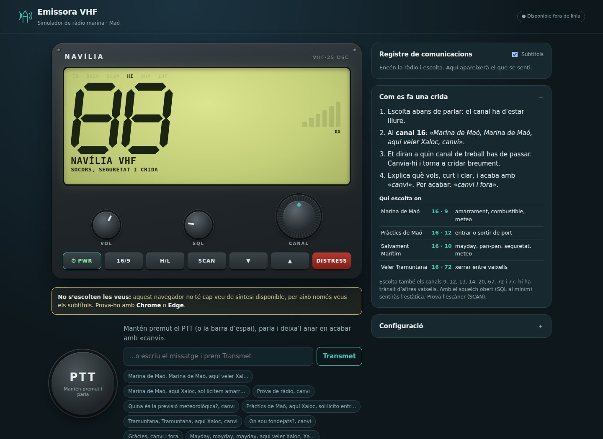
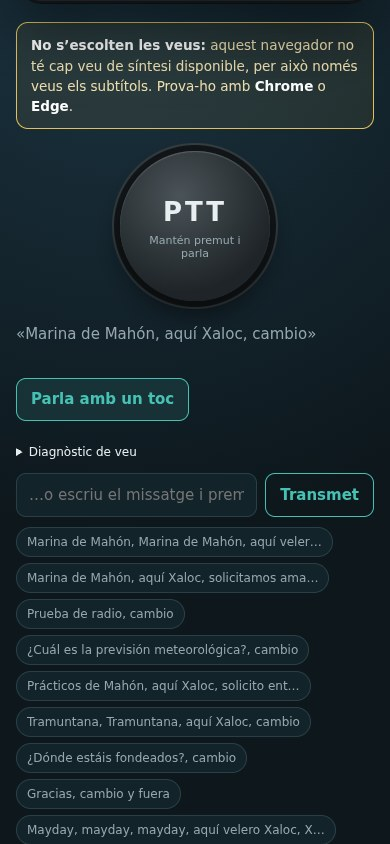

# Emissora VHF · simulador marí

Simulador didàctic d’una emissora VHF marina, ambientat al port de Maó. Tries el canal amb el dial, prems el PTT i parles amb la teva veu. Responen una marina, els pràctics, Salvament Marítim o un altre veler. Mentre gires el dial sents estàtica i converses d’altres vaixells.

[Català](#ca) · [Español](#es) · [English](#en)



<details>
<summary>Mòbil / Móvil / Mobile</summary>



</details>

<a id="ca"></a>

## Català

### Obrir-la

**En línia:** https://guirigall.github.io/EmissoraVHF/ (també s’hi pot instal·lar com a aplicació al mòbil).

**A l’ordinador**, des de la carpeta del projecte:

```bash
bash Obre-Emissora.sh
```

S’obre a `http://localhost:8090` amb **Chrome** si el tens (té veus i reconeixement de veu); si no, amb el navegador per defecte. A Linux, Firefox sovint no té cap veu de síntesi: l’app ho avisa i només mostra subtítols. Prem **PWR** per encendre la ràdio (el navegador només deixa fer so després d’un clic).

Al mòbil, obre l’adreça en línia i instal·la-la com a aplicació (Chrome → ⋮ → Instal·la l’aplicació). Funciona sense connexió, excepte el reconeixement de veu i la IA opcional.

### Com s’utilitza

- **Dial CANAL**: arrossega’l en cercle, fes servir la roda del ratolí o ▲▼. Canals 1–28 i 60–88 amb les freqüències reals.
- **SQL** (squelch): al mínim sents l’estàtica contínua; més amunt, només quan algú transmet.
- **PTT**: mantén-lo premut (o la barra d’espai), parla i deixa’l anar en acabar amb «canvi». També pots escriure el missatge i prémer *Transmet*.
- **16/9**: salta al canal 16 (o al 9). **H/L**: 25 W o 1 W (amb 1 W l’abast és curt). **SCAN**: recorre els canals i s’atura on parla algú.
- **DISTRESS**: mantén-lo premut 3 segons per enviar una alerta DSC de socors (simulada).

Dreceres: espai = PTT, P = encendre, 1 = 16/9, S = escàner, H = potència, ↑↓ = canal.

### Què hi trobaràs

Són escenaris ficticis del simulador, no una guia dels canals reals del port.

| Canal | Què hi passa |
|---|---|
| 16 | Crides, avisos de seguretat. Hi escolten totes les estacions. |
| 9 | Marina de Maó: amarraments, combustible, meteo. |
| 12, 14 | Pràctics de Maó: entrar o sortir de port, ferris i remolcadors. |
| 10, 6 | Salvament Marítim i exercicis de rescat. |
| 13 | Vaixells grans coordinant maniobres (en anglès). |
| 20 | Butlletí meteorològic de la ràdio costanera. |
| 67 | Comitè de regata. |
| 72, 77 | Navegants i pescadors xerrant (català i castellà). El veler *Tramuntana* hi contesta. |
| 8, 69, 73… | Converses llunyanes que no s’entenen. |
| 70, 87, 88 | Dades DSC i AIS: només ràfegues, no s’hi pot parlar. |

Les estacions responen en la llengua que triïs a **Configuració** (català, castellà o anglès), segons on les cridis, què demanis i la potència. Si oblides dir «canvi» o identificar-te, el registre et dona un consell. Si canvies de canal mentre et responen, et perds la resposta.

### Converses variades

Les converses de fons es generen sobre la marxa: vaixells, persones, cales, temes (fondeig, pesca, sopars, parte, avaries, dofins, meduses...), amarraments, ferris, regates, avisos de seguretat i butlletins meteo canvien cada vegada. També pots parlar amb la gent que acabes de sentir en un canal: digues-ne el nom (per exemple «Marta» o el nom del vaixell) i et contestarà en la seva llengua.

### Dues maneres d’entendre’t

- **Motor local** (per defecte, sense Internet ni cost): reconeix moltes maneres de dir les coses, tolera errors d’escriptura i de reconeixement de veu, i quan no t’entén et diu què et pot oferir. Però és limitat: amb frases molt imprevistes pot no encertar.
- **Mode IA amb Claude** (opcional, a Configuració): permet converses més obertes i respon amb naturalitat, recordant el que s’ha dit al canal. Cal una clau d’API d’Anthropic (console.anthropic.com), que es desa només en aquest navegador; el cost depèn del model escollit i de l’ús de l’API. L’app continua decidint qui et pot sentir (canal i abast); Claude decideix qui contesta i què diu. Si no hi ha connexió o la clau falla, respon el motor local i el registre ho indica. Fes servir una clau amb límit de despesa i no publiquis l’app amb la clau posada.

### Límits

- El reconeixement de veu és el del navegador: Chrome i Edge el tenen (envien l’àudio als seus servidors i necessiten Internet); Firefox no. Sense reconeixement, fes servir el text.
- Les veus són les instal·lades al sistema. Si no n’hi ha cap de catalana, les frases en català es llegeixen amb una altra veu.
- Les veus sintètiques no passen pel filtre de ràdio (el navegador no ho permet). L’estàtica, el squelch, els clics i les veus llunyanes sí que es generen amb filtre de ràdio.
- Les estacions, els vaixells i els diàlegs són inventats i simplificats. No substitueix la formació per al títol d’operador de ràdio ni s’ha d’usar per navegar. En una emergència real, truca al 112.

### Desenvolupament

Sense dependències ni compilació. Proves:

```bash
npm test
```

Fitxers principals: `channels.js` (pla de canals), `dialog.js` i `chatter.js` (motor local), `ai.js` (mode IA), `traffic.js` (converses de fons generades), `audio.js` (so), `voice.js` (veu), `app.js` (interfície). `vendor/anthropic-sdk.mjs` és el SDK oficial d’Anthropic (`@anthropic-ai/sdk` 1.8.0) empaquetat per al navegador; només es carrega si actives el mode IA.

<a id="es"></a>

## Español

Simulador educativo de una emisora VHF marina ambientado en el puerto de Maó. Selecciona un canal, mantén pulsado PTT y habla: pueden responder la marina, los prácticos, Salvamento Marítimo u otro velero. Al girar el dial se oyen estática y conversaciones de otros barcos.

### Abrir e instalar

[Abre la aplicación](https://guirigall.github.io/EmissoraVHF/) y pulsa **PWR** para encenderla y autorizar el sonido. En Android, usa Chrome → ⋮ → Instalar aplicación. También puedes ejecutar desde la carpeta del proyecto:

```bash
bash Obre-Emissora.sh
```

El lanzador abre `http://localhost:8090` en Chrome si está instalado; en caso contrario, utiliza el navegador predeterminado. En Linux, Firefox puede carecer de voces: la aplicación lo indica y muestra subtítulos. Tras cargarla e instalarla, el motor local funciona sin conexión; el reconocimiento de voz y la IA opcional necesitan Internet.

### Controles

- **CANAL:** arrastra el dial en círculo, usa la rueda o ▲▼. Incluye canales 1–28 y 60–88 con sus frecuencias.
- **SQL:** al mínimo se oye estática continua; al subirlo, solo se escuchan transmisiones.
- **PTT:** mantenlo pulsado, habla y suéltalo al terminar con «cambio». Puedes escribir el mensaje y pulsar *Transmet*.
- **16/9:** acceso a estos canales. **H/L:** 25 W o 1 W; con 1 W disminuye el alcance simulado. **SCAN:** recorre canales y se detiene al detectar actividad.
- **DISTRESS:** mantenlo pulsado tres segundos para emitir una alerta DSC de socorro simulada.

Teclado: espacio = PTT; P = encendido; 1 = 16/9; S = escáner; H = potencia; ↑↓ = canal.

### Escenarios por canal

Son escenarios ficticios del simulador, no una guía de asignaciones reales del puerto.

| Canal | Contenido simulado |
|---|---|
| 16 | Llamadas y seguridad; todas las estaciones están a la escucha. |
| 9 | Marina de Maó: amarres, combustible y meteorología. |
| 12, 14 | Prácticos: entradas y salidas, ferris y remolcadores. |
| 10, 6 | Salvamento Marítimo y ejercicios de rescate. |
| 13 | Coordinación de grandes buques en inglés. |
| 20 | Boletín meteorológico de la estación costera. |
| 67 | Comité de regatas. |
| 72, 77 | Navegantes y pescadores en catalán y español; responde el velero *Tramuntana*. |
| 8, 69, 73… | Conversaciones lejanas e ininteligibles. |
| 70, 87, 88 | Ráfagas de datos DSC/AIS; no admiten voz. |

En **Configuració**, elige catalán, español o inglés para las respuestas. Las estaciones tienen en cuenta el canal, la petición y la potencia. El registro ofrece consejos si olvidas identificarte o decir «cambio». Si cambias de canal durante una respuesta, dejarás de oírla.

Las conversaciones de fondo varían: barcos, personas, calas, fondeo, pesca, cenas, previsiones, averías, delfines, medusas, amarres, ferris, regatas y seguridad. Puedes dirigirte por su nombre a una persona o un barco que acabas de escuchar y responderá en su idioma.

### Motor local e IA opcional

El **motor local**, activado por defecto, es gratuito y funciona sin Internet. Tolera distintas formulaciones, errores de escritura y de reconocimiento; ofrece opciones si no entiende, aunque tiene límites ante frases inesperadas.

El **modo Claude**, opcional en configuración, utiliza una clave de API de Anthropic guardada únicamente en ese navegador. Conserva el contexto de la conversación por canal. La aplicación determina quién puede oírte según canal y alcance; Claude genera las respuestas. El coste depende del modelo y del uso de la API. Usa un límite de gasto y no publiques la clave. Si falla la conexión o la clave, responde el motor local y queda constancia en el registro.

### Límites

- El reconocimiento de voz depende del navegador. En esta aplicación, Chrome y Edge envían el audio a sus servidores y necesitan conexión; Firefox requiere la alternativa de texto.
- Las voces son las instaladas en el sistema. Si falta una voz catalana, se usa otra voz.
- La voz sintetizada no pasa por el filtro de radio; la estática, el squelch, los clics y las voces lejanas sí tienen ese efecto.
- Estaciones, barcos y diálogos son inventados y simplificados. No sustituye la formación de radiooperador ni debe utilizarse para navegar. En una emergencia real, llama al 112.

### Desarrollo

No necesita compilación ni instalación de dependencias para el funcionamiento local. Ejecuta las pruebas con:

```bash
npm test
```

Archivos: `channels.js` (canales), `dialog.js` y `chatter.js` (motor local), `ai.js` (IA), `traffic.js` (conversaciones), `audio.js` (sonido), `voice.js` (voz) y `app.js` (interfaz). `vendor/anthropic-sdk.mjs` contiene el SDK de Anthropic para navegador y solo se carga al activar la IA.

<a id="en"></a>

## English

An educational marine VHF simulator set in Maó harbour. Select a channel, hold PTT and speak: the marina, harbour pilots, maritime rescue or another sailing boat may answer. Turning the dial reveals static and conversations between other vessels.

### Open and install

[Open the application](https://guirigall.github.io/EmissoraVHF/) and press **PWR** to turn it on and enable audio. On Android, use Chrome → ⋮ → Install app. Alternatively, run this from the project folder:

```bash
bash Obre-Emissora.sh
```

The launcher opens `http://localhost:8090` in Chrome when installed, otherwise in your default browser. Firefox on Linux may have no speech synthesis voices; the app warns you and displays subtitles. Once loaded and installed, the local engine works offline; speech recognition and optional AI require Internet access.

### Controls

- **CANAL:** drag the dial in a circle, use the mouse wheel or ▲▼. Includes channels 1–28 and 60–88 with their frequencies.
- **SQL:** minimum squelch produces continuous static; increase it to hear transmissions only.
- **PTT:** hold, speak, then release after ending with “over”. You can also type a message and press *Transmet*.
- **16/9:** jump to these channels. **H/L:** 25 W or 1 W; 1 W reduces simulated range. **SCAN:** scans channels and stops on activity.
- **DISTRESS:** hold for three seconds to send a simulated DSC distress alert.

Keyboard: Space = PTT; P = power; 1 = 16/9; S = scan; H = transmit power; ↑↓ = channel.

### Channel scenarios

These are fictional simulator scenarios, not a guide to actual harbour channel assignments.

| Channel | Simulated activity |
|---|---|
| 16 | Calls and safety announcements; all stations listen. |
| 9 | Maó marina: berths, fuel and weather. |
| 12, 14 | Harbour pilots: arrivals, departures, ferries and tugs. |
| 10, 6 | Maritime rescue and rescue exercises. |
| 13 | Large vessels coordinating manoeuvres in English. |
| 20 | Coastal radio weather bulletin. |
| 67 | Race committee. |
| 72, 77 | Sailors and fishers chatting in Catalan and Spanish; the yacht *Tramuntana* answers. |
| 8, 69, 73… | Unintelligible distant conversations. |
| 70, 87, 88 | DSC/AIS data bursts; no voice communication. |

Choose Catalan, Spanish or English for replies in **Configuració**. Stations respond according to channel, request and power. The log offers advice if you forget your identification or “over”. Changing channel during a reply means you will miss it.

Background conversations vary in vessels, people, coves and topics: anchoring, fishing, meals, forecasts, breakdowns, dolphins, jellyfish, berths, ferries, races and safety. Address a person or boat you have just heard by name and they will answer in their language.

### Local engine and optional AI

The default **local engine** is free and works offline. It handles different phrasings, typing mistakes and speech recognition errors, and offers options when it cannot understand. Unexpected requests can exceed its limits.

Optional **Claude mode**, enabled in settings, requires an Anthropic API key stored only in that browser. Conversation context is maintained per channel. The app determines who can hear you based on channel and range; Claude generates replies. API charges depend on the selected model and usage. Set a spending limit and do not publish your key. Connection or key failures fall back to the local engine and are recorded in the log.

### Limitations

- Speech recognition depends on the browser. In this app, Chrome and Edge send audio to their servers and require Internet; Firefox users can use text instead.
- Speech synthesis uses system voices. If a Catalan voice is unavailable, another voice is used.
- Synthesized speech bypasses the radio filter because of browser API limitations. Static, squelch, clicks and distant voices use radio effects.
- Stations, vessels and dialogue are fictional and simplified. This does not replace radiooperator training and must not be used for navigation. In a real emergency, call 112.

### Development

No build or dependency installation is required for local operation. Run the tests with:

```bash
npm test
```

Main files: `channels.js` (channels), `dialog.js` and `chatter.js` (local engine), `ai.js` (AI), `traffic.js` (background conversations), `audio.js` (sound), `voice.js` (speech), and `app.js` (interface). `vendor/anthropic-sdk.mjs` bundles the Anthropic browser SDK and loads only when AI mode is enabled.

---

Les captures d’ordinador i mòbil es regeneren amb GitHub Actions, executant l’aplicació real amb Chromium. / Las capturas se regeneran con GitHub Actions y Chromium. / Screenshots are regenerated using GitHub Actions and Chromium.
